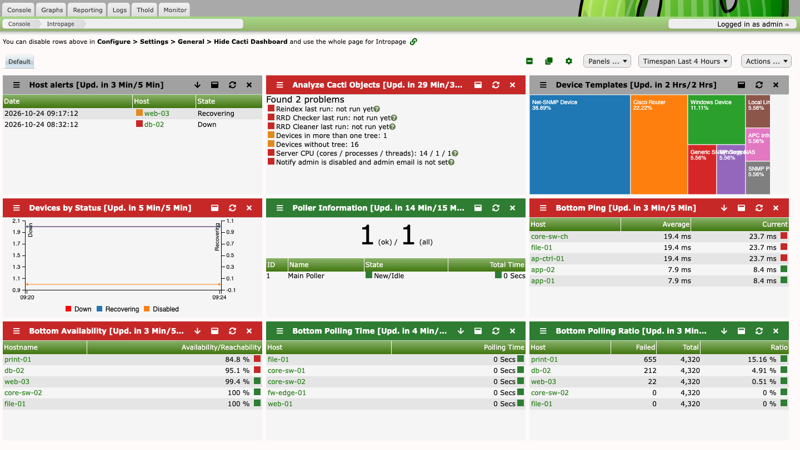
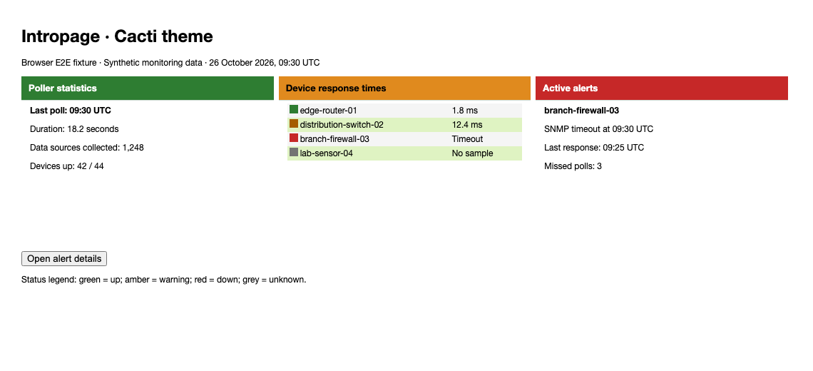
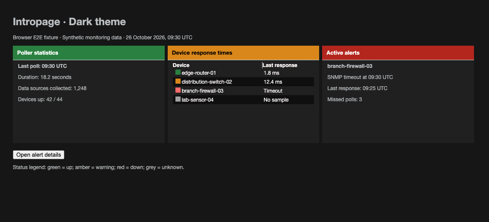
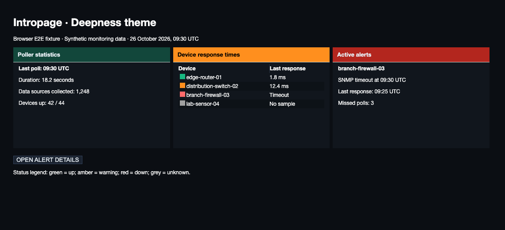
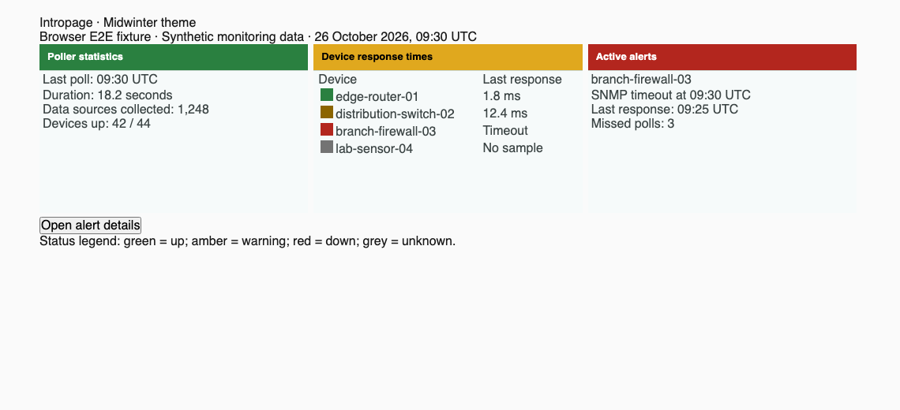

# plugin_intropage

## Intropage/Dashboard plugin for Cacti

Intropage adds dashboards made of panels to Cacti. A panel shows one piece of
information, for example the state of the devices, the poller statistics, an
analysis of the Cacti log, the worst ping times or the last threshold events,
or a graph that a user has added. The dashboards are shown on the console page
or on a separate tab. A script that the Cacti poller starts after every
polling cycle collects the data the panels show.

## Original Author

All thanks goes to Petr Macek (petr.macek@kostax.cz) the original author of
Intropage! He has turned over the Intropage Plugin to the broader Cacti
community for long term management.  We would like to thank him for all his
contributions past, present and future.

## Screenshot

A dashboard with nine panels: host alerts, an analysis of the Cacti objects,
devices by template and by status, poller information, and the five worst
devices by ping, availability, polling time and polling ratio. The screenshot
was taken on Cacti 1.2.32 with demo devices.

The Cacti theme browser E2E fixture uses synthetic device data to exercise
severity indicators on light table rows and dark details titlebars. See
[Cacti theme validation](docs/cacti-theme.md) for the details screenshot and
reproduction commands.

The Carrot fixture checks status markers on light rows and a contrasting
details badge that works with existing coral titlebars. See
[Carrot theme validation](docs/carrot-theme.md) for screenshots and tests.

The Dark fixture includes a visible red row marker for the failed device.
See [Dark theme validation](docs/dark-theme.md) for screenshots and tests.

The Deepness fixture checks contrasting green and red row markers on dark
surfaces. See [Deepness theme validation](docs/deepness-theme.md) for screenshots
and reproduction commands.

The Hollyberry fixture checks readable details dots and row markers. See
[Hollyberry theme validation](docs/hollyberry-theme.md) for screenshots and tests.

Midwinter's dark and light fixtures check panel text, row markers, and alert colors
in real details dialogs. See [Midwinter theme validation](docs/midwinter-theme.md)
for screenshots and reproduction commands.

## Requirements

- Cacti 1.2.17 or later (the `compat` value in the `INFO` file). The plugin is
  tested in CI against the 1.2.x branch of Cacti, and it installs, enables and
  runs its poller script on the Cacti development branch (1.3).
- PHP 8.0 or later for the plugin code. The Cacti release you run decides
  the PHP version you need: Cacti 1.2.32 refuses to start below PHP 8.2 and the
  Cacti development branch below PHP 8.3.
- The Cacti poller has to run. The panel data comes from
  `poller_intropage.php`, which Cacti starts in the background at the end of
  each polling cycle with the PHP binary from Console > Configuration >
  Settings > Paths (`php` when that is empty).
- Data Source Statistics (Console > Configuration > Settings > Data) for the
  "Busiest ..." panels and "Analyze DS stats". The panels show a notice and a
  link to the setting while it is off.
- The PHP `sockets` extension for the NTP check of the "NTP/DNS Status" panel.
  Cacti itself lists it as required.

### Other plugins

Intropage works without any other plugin. These panels are only offered when
the plugin they need is installed, and they show a message when it is
installed but not enabled:

| Plugin | Panels |
| --- | --- |
| thold | Last Threshold Events, Threshold, 24 Hour Extremes |
| syslog | Syslog Details, Syslog Top Devices, Syslog Message levels |
| mactrack | MacTrack Plugin, MacTrack Sites |
| maint | Maint Plugin Details |
| webseer | Webseer Details |
| servcheck | Servcheck plugin Details |

Two checks in the "Analyze Cacti Objects" panel use plugins as well: the
count of devices without monitoring needs the monitor plugin to be enabled, and
the list of thresholds that only log needs thold to be enabled.

If the Maint plugin is enabled and "Upcoming Maint Schedule warning days" is
not "Never warn", the Maint panel of a user who has it is shown first on the
first dashboard of that user.

With "Automatically Uninstall Panels" checked, the stored panels of a plugin
that is no longer installed are removed.

## Installation

- Copy the directory `intropage` to the Cacti `plugins` directory. The
  directory name has to be `intropage`.

- Check the file permissions (Linux/unix - readable for the web server)

- Install and enable the plugin (Console > Configuration > Plugins). Installing
  creates the tables, the two realms and the hooks; the plugin is not active
  until it is enabled.

  The same from the command line, in the Cacti directory:

      php cli/plugin_manage.php --plugin=intropage --install --enable

- Configure the plugin (Console > Configuration > Settings > Intropage tab)

- Give the users access to panels (Console > Configuration > Users > (edit) >
  Intropage tab, or Console > Configuration > User Groups > (edit) > Intropage
  tab). A user can use a panel when the user or one of the groups of the user
  has it.

Who has what after the installation:

- Only the Cacti admin user (user 1) gets the two realms listed below. Give the
  other users the "Intropage Viewer" realm under Plugin Permissions on the
  Permissions tab of the user or of a group (Console > Configuration > Users or
  User Groups).
- The user who installs the plugin from the web gets every panel. For an
  installation from the command line this is the Cacti admin user.
- A user created or copied later gets all user level panels and "Favorite
  Graphs". The system level panels have to be granted one by one.
- Users that exist already see an empty dashboard until they are given panels.

The plugin adds two realms. "Intropage Viewer" opens the dashboard and is part
of the Normal User role. "Intropage Administration" is part of the System
Administration role; it allows "Reload Panel Definitions" and changing the
update frequencies of the system panels.

More information about installation and upgrade of plugins:
https://docs.cacti.net/Plugins.md

## Upgrade

- Replace the files of the plugin directory with the new version (or update the
  git checkout).

- Keep your own panel libraries. If you remove the old directory, copy the
  files you added to `panellib` back.

- Disable and enable the plugin in the console (Console > Configuration >
  Plugins), or just open the dashboard. When the version in `INFO` is newer
  than the version stored in Cacti, the plugin changes its tables and stores
  the new version. Cacti runs this check when the plugin is installed or
  enabled, and the dashboard runs it on every load.

- Check the settings (Console > Configuration > Settings > Intropage tab).

The upgrade also cleans the plugin directory according to `manifest.json`:
the old `include` and `themes` directories, the `tests` directory and
`phpunit.xml` are removed. Any other file or directory in the top level of
the plugin directory that `manifest.json` does not list is left in place and
reported in the Cacti log.

## Uninstall

Disable and uninstall the plugin (Console > Configuration > Plugins), or run
the command line with `--disable` and then `--uninstall`. Uninstalling drops
the tables below, removes the plugin hooks, realms and the settings that start
with `intropage_`, and sets the login option of users who had the Intropage tab
back to the console. The personal settings of users (rows in `settings_user`
that start with `intropage_`) are not removed.

## Using the dashboards

A user can have up to 9 dashboards. The first one cannot be removed. Dashboards
are chosen with the tabs above the panels. The tools are in the bar above:

- The "Panels" list adds a panel. Panels the user is not allowed to use are
  disabled in the list.
- The cog icon opens the page to name the dashboards and to change how often a
  panel is updated. Administrators can also change the system panels there.
- The "Actions" list adds and removes dashboards, sets the number of lines of
  the panels (5, 10 or 15), the automatic page refresh, the period that is
  highlighted as important, the sort order (by severity or as arranged), and
  wider panels, and it shares a dashboard. The timespan list next to it sets
  the timespan of the trend charts. These choices are stored per user and the
  defaults come from the Intropage tab of the Cacti settings.
- Panels can be moved by dragging, made higher or lower, opened in a larger
  detail window, reloaded (if the panel allows it) and disabled. The icon with
  the two squares turns dragging off so text can be copied from a panel, and
  the icon with the minus sign hides or shows the red, yellow and green
  squares.

A shared dashboard shows up in the Actions list of the other users as "Use
shared dashboard". Using it copies the panels with their current data into a new
dashboard of that user; panels the user has no permission for are removed again
when the dashboard is opened. A dashboard without panels cannot be shared.

The Actions list can also move the dashboard: "Display Intropage in Console"
shows it below the Cacti console, "Display Intropage in Tab as Default Page"
shows it on its own tab and makes it the page after login.

### Favorite graphs

To add a graph, open it and click the eye icon next to it. The graph appears as
a panel with the timespan that was selected. The icon is shown to users who
have the "Favorite Graphs" panel and it does not work for a custom (zoomed)
timespan. The graph is shown in the image format of the graph (PNG or SVG), as
Cacti serves it.

## Settings

Console > Configuration > Settings > Intropage. Users can change the display
choices for themselves in the Actions list.

| Setting | Default | Values |
| --- | --- | --- |
| Important things will be at the top | off | on, off |
| Display more panels on a line | off | on, off |
| Automatically Uninstall Panels | off | on, off |
| Automatic Page Refresh | Every Minute | Automatically by poller, Never, Every Minute, Every 5 Minutes, Every Hour |
| Important period | 1 hour | Disabled, 15 minutes, 1 hour, 4 hours, 1 day |
| Number of panel lines | 5 | 5, 10, 15 |
| Trend Timespan | Last 4 Hours | 1, 2, 3, 4, 6, 12 hours, 1 day, 2 days |
| Poller Timeout | 30 Minutes | 1, 5, 10, 15, 20, 30, 40, 60 minutes |
| Analyze Log - number of lines | 500 | up to 5 digits |
| Analyze DB - Level of db check | Changed | Quick, Fast, Changed, Medium, Extended |
| NTP Time Check - IP or DNS name of NTP server | pool.ntp.org | an IP address or name, up to 50 characters |
| DNS Check - Any DNS name | dns.google | a name, up to 50 characters |
| Admin Information Panel | empty | text of up to 1000 characters, shown as plain text in a panel at the top of the first dashboard when longer than 3 characters |
| Upcoming Maint Schedule warning days | 1 Day Before | Never warn, When maintenance starts, 1, 3, 7 days before |
| Network stats in | Bits | Bytes, Bits |

The "Alarm Settings" choose the colour (red, yellow or green) of the panel for
each analysis result, such as aborted database clients, orphaned data
sources, devices without a tree, graph or monitoring, or non-empty poller
output, and the thresholds for the polling time, polling ratio, ping and
availability panels.

"How often analyze DB", "How often check NTP" and "How often check DNS" are
shown on the page but nothing reads them. How often those panels run is set
with the update frequency of the panel (the cog icon): by default 1 day for
"Database Checks" and 2 hours for "NTP/DNS Status", which does both checks.

## The poller script

`poller_intropage.php` is started by the hook `poller_bottom` after each
polling cycle. It can also be run by hand from the plugin directory:

    php poller_intropage.php [--force] [--debug]
    php poller_intropage.php --version
    php poller_intropage.php --help

- `--debug` prints each step and its duration.
- `--force` is accepted and listed in the help, but the script does not read
  it, so it changes nothing.

It runs for every panel row that is due, as the owner of the row, and stores
the result in the database. Only one copy runs at a time and a second start
ends quietly; the "Poller Timeout" setting limits how long a copy may run. On
each run the script also moves the plugin to the first place in the order of
the Cacti plugins. Trend values are kept for 2 days.

Each panel has its own update frequency and, for trend panels, its own trend
frequency. The defaults are part of the panel and a user can change the ones
for their own panels with the cog icon.

## Panels

| Group | Panel | Level | Needs |
| --- | --- | --- | --- |
| Alerts | Host alerts | user | |
| Analysis | Analyze Logins, Analyze Logs, Database Checks, Analyze DS stats | system | Analyze DS stats: Data Source Statistics |
| Analysis | Analyze Cacti Objects | user | |
| The busiest | Busiest CPU, Busiest ucd/net - Load, Busiest Hard Drive Space, Busiest uptime, Busiest Interface in/out traffic, Busiest Interface error, Busiest Interface utilization | user | Data Source Statistics |
| Graphical | Data Sources, Device Templates, Devices by Status | user | |
| Miscellaneous | NTP/DNS Status | system | |
| Miscellaneous | Maint Plugin Details | user | maint |
| Miscellaneous | Webseer Details | system | webseer |
| Miscellaneous | Servcheck plugin Details | system | servcheck |
| Poller | Poller Information, Poller Statistics, Poller Output Items | system | |
| System | Information, Administrative Alerts, Boost Statistics, Boost History, CPU Utilization | system | |
| System | 24 Hour Extremes | user | thold |
| Top/Bottom 5 | Bottom Ping, Bottom Availability, Bottom Polling Time, Bottom Polling Ratio | user | |
| Syslog | Syslog Details, Syslog Top Devices, Syslog Message levels | system | syslog |
| Threshold | Last Threshold Events, Threshold | user | thold |
| MacTrack | MacTrack Plugin, MacTrack Sites | user | mactrack |
| Favorite Graphs | graphs added with the eye icon | user | |

System level panels show the same to every user. User level panels are
limited to what the user is allowed to see in Cacti.

## Tables

The installation creates these tables: `plugin_intropage_panel_definition`,
`plugin_intropage_panel_data`, `plugin_intropage_panel_dashboard`,
`plugin_intropage_dashboard`, `plugin_intropage_user_auth`,
`plugin_intropage_user_group_auth` and `plugin_intropage_trends`.

## How to add new Panel Libraries and Panels?

Panels are defined in the files of the `panellib` directory. Copy one of the
existing files to a new file name and change it; every `.php` file in the
directory is loaded. Each file has a registration function named
`register_` plus the file name without `.php`, for example
`register_example()` in `example.php`. It returns the array of panels of the
file, and it names the group of the panels in the global `$registry`.

Use unique panel ids. A minimal file, tested on Cacti 1.2.32 and on the
development branch:

    <?php
    function register_example(): array {
        global $registry;

        $registry['example'] = [
            'name'        => __('Example Panels', 'intropage'),
            'description' => __('Panels of the example', 'intropage')
        ];

        return [
            'example_panel' => [
                'name'         => __('Example Panel', 'intropage'),
                'description'  => __('Example', 'intropage'),
                'class'        => 'example',
                'level'        => PANEL_USER,
                'refresh'      => 900,
                'trefresh'     => false,
                'force'        => true,
                'width'        => 'quarter-panel',
                'height'       => 'normal',
                'height_fixed' => true,
                'priority'     => 28,
                'alarm'        => 'green',
                'requires'     => false,
                'update_func'  => 'example_panel',
                'details_func' => false,
                'trends_func'  => false
            ]
        ];
    }

    function example_panel($panel, $user_id): void {
        $panel['alarm'] = 'green';
        $panel['data']  = 'hello';

        save_panel_result($panel, $user_id);
    }

After adding or changing a file, an administrator runs "Reload Panel
Definitions" in the Actions list; then the panel can be given to users and
added to a dashboard. The keys are described in `panellib/README.md`.

`intropage_add_panel()` and `intropage_remove_panel()` in `setup.php` do not
work with the current tables and are not a way to add a panel. A panel library
file in `panellib` is the only way, and a plugin cannot supply its own file
from its own directory: the file has to be copied into the `panellib`
directory of Intropage.

## Translations

The texts use the text domain `intropage`. The sources are in `locales/po`
(`cacti.pot` and one `.po` file per language) and the compiled files Cacti
loads are in `locales/LC_MESSAGES` as `<language>.mo`. After changing a text,
run `sh locales/build_gettext.sh` from the plugin directory. It needs the GNU
gettext tools (`xgettext`, `msgmerge`, `msgfmt`) and writes `cacti.pot`,
updates every `.po` file and compiles the `.mo` files. `sh locales/build_mo.sh`
run from `locales` only compiles the `.mo` files again. The language files in
this version: ar-SA, bg-BG, de-DE, el-GR, es-ES, fr-FR, he-IL, hi-IN, it-IT,
ja-JP, ka-GE (no compiled file yet), ko-KR, nl-NL, pl-PL, pt-BR, pt-PT,
ru-RU, sv-SE, tr-TR, vi-VN, zh-CN, zh-TW.

## Development and tests

The tests run inside a Cacti installation with its Composer packages
installed, with the plugin in its `plugins/intropage` directory. They use stub
functions for the database and the Cacti API and do not need a database. The
file `tests/.cacti-version` holds `1.2.x`, which accepts any Cacti release;
any other value has to be equal to `include/cacti_version`.

From the Cacti directory:

    include/vendor/bin/pest --configuration=plugins/intropage/phpunit.xml

Add `--coverage-clover=plugins/intropage/coverage/clover.xml` to write a
coverage report (needs Xdebug). From the plugin directory:

    php tests/bin/validate-manifest.php
    php tests/bin/check-i18n-pot.php origin/develop
    php tests/bin/patch-coverage.php coverage/clover.xml origin/develop 100

- `validate-manifest.php` checks that `manifest.json` lists what is in the
  plugin directory.
- `check-i18n-pot.php` fails when translatable strings changed and
  `locales/po/cacti.pot` did not.
- `patch-coverage.php` fails when less than the given percent of the changed
  lines is covered.

The CI workflow `.github/workflows/plugin-ci-workflow.yml` installs Cacti 1.2.x
with MariaDB, installs the plugin with `plugin_manage.php`, checks the syntax
of every PHP file, runs these checks and the tests, and runs a poller cycle.

## Possible Bugs?

If you find a problem, open an issue at
https://github.com/Cacti/plugin_intropage/issues or write to
https://forums.cacti.net/viewtopic.php?f=5&t=51920

## Thanks

Tomas Macek, Peter Michael Calum, Trevor Leadley, Earendil

-----------------------------------------------
Copyright (c) 2004-2026 - The Cacti Group, Inc.
