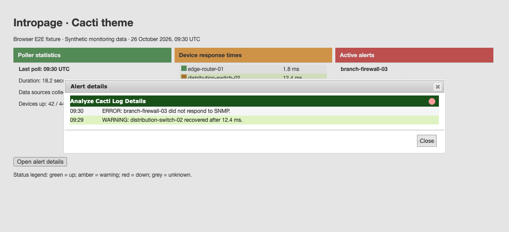

# Cacti theme validation

Intropage's Cacti theme uses brighter severity dots on dark details titlebars
and darker warning and unknown markers on light table rows. All four severity
indicators must retain at least 3:1 contrast on their respective surfaces.

## Seeded browser E2E fixture

The screenshots use `tests/fixtures/Ui/cacti-theme.html` with synthetic devices,
ping times, collected data-source counts, and poller alerts. They render the
real plugin and core stylesheets with jQuery UI. They do not show a live Cacti
installation or production data.


The fixture opens the details dialog, checks its alert data, and closes it
through the Close button. The titlebar retains a visible red status dot.



## Reproduce

Use an adjacent Cacti develop checkout for its locked Playwright tooling and
theme assets. From the plugin root, set `CACTI_ROOT` to that checkout:

```sh
export CACTI_ROOT=/path/to/cacti
mise exec node@22 -- npm ci --ignore-scripts --prefix "$CACTI_ROOT/tests/e2e"
mise exec node@22 -- "$CACTI_ROOT/tests/e2e/node_modules/.bin/playwright" install chromium
NODE_PATH="$CACTI_ROOT/tests/e2e/node_modules" mise exec node@22 -- \
  "$CACTI_ROOT/tests/e2e/node_modules/.bin/playwright" test \
  --config tests/e2e/playwright.config.cjs
```

Set `UPDATE_THEME_SCREENSHOTS=1` on the test command to regenerate the committed
images. Normal runs attach screenshots and CSS coverage evidence to
`tests/e2e/test-results`. Tests measure all four status colors on white,
odd-row, and even-row backgrounds using their computed browser styles.

After committing, require complete changed CSS line coverage:

```sh
mise exec python@3.12 -- python "$CACTI_ROOT/tests/tools/report_changed_coverage.py" \
  --base origin/develop --language css --minimum 100 \
  --browser-root tests/e2e/test-results
```

The browser job runs these tests and requires 100% coverage of changed CSS
lines. This does not represent whole-plugin coverage or live-installation
testing.
