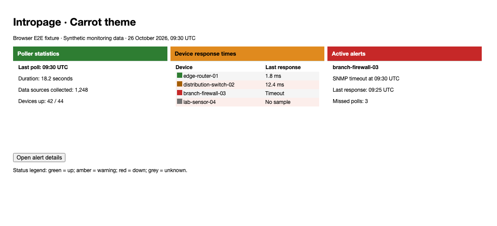
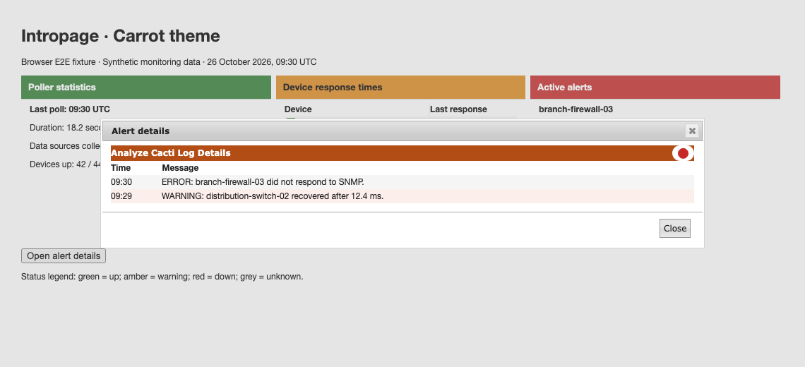

# Carrot theme validation

Carrot's details indicators have a white backing inside Intropage's details
titlebar. This makes their contrast independent of the host titlebar color,
including the existing coral background and darker core theme backgrounds.
Warning and unknown row markers use darker colors against light table rows.

## Seeded browser E2E fixture

The screenshots reuse `tests/fixtures/Ui/cacti-theme.html` with Carrot's actual
plugin and core stylesheets. They contain synthetic device names, ping times,
poller totals, and warning/error messages rather than production data.



The E2E test opens and closes the real jQuery UI details dialog. The severity
badge is scoped to `#overlay_detail`, so it does not restyle core titlebars.



## Reproduce

Use the dependency setup and browser commands in
[Cacti theme validation](cacti-theme.md). The suite now exercises both themes,
including all four severity indicators on white, odd-row, and even-row
backgrounds. Set `UPDATE_THEME_SCREENSHOTS=1` to regenerate the screenshots.

After committing, measure this fix's changed CSS coverage from the plugin root:

```sh
mise exec python@3.12 -- python "$CACTI_ROOT/tests/tools/report_changed_coverage.py" \
  --base fix/cacti-theme-status-contrast --language css --minimum 100 \
  --browser-root tests/e2e/test-results
```

This is the parent branch while the PR is stacked. Use `origin/develop` after
the parent merges. The percentage describes executed changed CSS lines, not
whole-plugin coverage or testing against a live Cacti installation.
