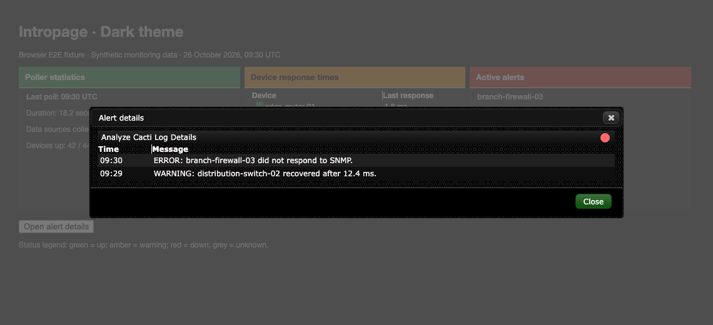

# Dark theme validation

Dark's red row marker uses a brighter red against dark table rows. The panel
header retains its darker red background and white text. Existing details
status dots remain unchanged.

## Seeded browser E2E fixture

The screenshots render the actual plugin and core Dark stylesheets with
synthetic devices, ping times, poller totals, and warning/error messages.
They do not show a live Cacti installation or production monitoring data.


The E2E test opens and closes the real jQuery UI details dialog and checks
that its alert data is visible.



## Reproduce

Use the setup in [Cacti theme validation](cacti-theme.md). With `CACTI_ROOT`
pointing to the adjacent core checkout, run from the plugin root:

```sh
NODE_PATH="$CACTI_ROOT/tests/e2e/node_modules" mise exec node@22 -- node \
  "$CACTI_ROOT/tests/e2e/node_modules/@playwright/test/cli.js" test \
  --config tests/e2e/playwright.config.cjs
```

Set `UPDATE_THEME_SCREENSHOTS=1` to regenerate the screenshots. The suite
checks all four status colors on odd, even, and page surfaces and includes
linear-gradient endpoints in its contrast calculation.

After committing, measure the changed CSS lines:

```sh
mise exec python@3.12 -- python "$CACTI_ROOT/tests/tools/report_changed_coverage.py" \
  --base fix/carrot-theme-status-contrast --language css --minimum 100 \
  --browser-root tests/e2e/test-results
```

Use `origin/develop` after the parent branch merges. This measures changed CSS
coverage, not whole-plugin coverage or testing against a live installation.
