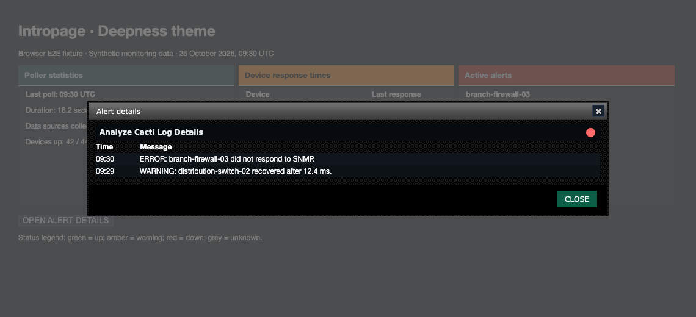

# Deepness theme validation

Deepness uses opaque green and brighter red row markers so device states remain
visible on dark table rows. Panel headers keep their existing backgrounds and
text colors, and details dots retain their existing colors.

## Populated browser fixtures

The screenshots use actual core and plugin Deepness stylesheets with synthetic
devices, ping times, poller totals, and alerts. They are fixture screenshots,
not a live installation or production monitoring output.


The browser test opens the real jQuery UI details dialog, checks its warning
and error messages, and closes it.



## Reproduce

Follow the dependency setup in [Cacti theme validation](cacti-theme.md).
With `CACTI_ROOT` pointing to the adjacent core checkout, run from the plugin root:

```sh
NODE_PATH="$CACTI_ROOT/tests/e2e/node_modules" mise exec node@22 -- node \
  "$CACTI_ROOT/tests/e2e/node_modules/@playwright/test/cli.js" test \
  --config tests/e2e/playwright.config.cjs
```

Set `UPDATE_THEME_SCREENSHOTS=1` to regenerate the committed screenshots.
The tests check all four status colors on odd, even, and page surfaces, including
alpha composition and linear-gradient stops. Status markers must meet 3:1
contrast against their backgrounds.

After committing, measure changed CSS line coverage:

```sh
mise exec python@3.12 -- python "$CACTI_ROOT/tests/tools/report_changed_coverage.py" \
  --base fix/dark-theme-status-contrast --language css --minimum 100 \
  --browser-root tests/e2e/test-results
```

This PR extends the existing browser harness above the Dark fix. Use
`origin/develop` after the lower stack layers merge. This gate measures executed
changed CSS lines, not whole-plugin or branch coverage.
