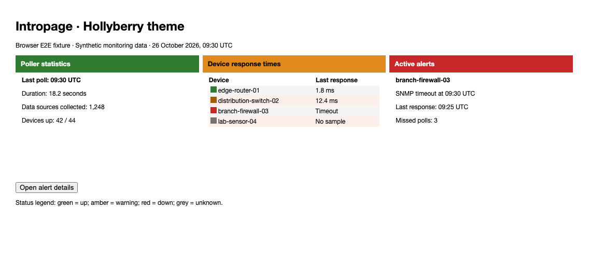
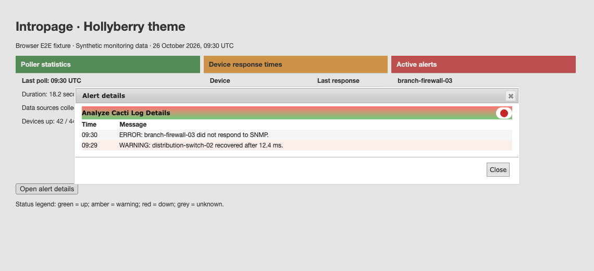

# Hollyberry theme validation

Hollyberry details dots sit on a neutral badge so their colors remain visible
against the core title gradient. Amber and grey row markers use darker colors
on light rows. Panel header backgrounds and text colors retain their palette.

## Populated browser fixtures

The screenshots use actual core and plugin Hollyberry stylesheets with synthetic
devices, response times, poller totals, and warning/error messages. They show
browser fixtures, not a live installation or production monitoring data.



The browser test opens the real jQuery UI details dialog, checks its alert data,
and closes it.



## Reproduce

Use the setup in [Cacti theme validation](cacti-theme.md). Set `CACTI_ROOT` to the
adjacent core checkout and run from the plugin root:

```sh
NODE_PATH="$CACTI_ROOT/tests/e2e/node_modules" mise exec node@22 -- node \
  "$CACTI_ROOT/tests/e2e/node_modules/@playwright/test/cli.js" test \
  --config tests/e2e/playwright.config.cjs
```

Set `UPDATE_THEME_SCREENSHOTS=1` to regenerate committed screenshots. The tests
check all four severity colors on odd, even, and page surfaces, including alpha
composition and samples at sRGB gradient endpoints and quarter points. Indicators
must meet 3:1 contrast against their backgrounds. Sampling does not prove contrast
at every pixel or against arbitrary background images.

After committing, measure changed CSS line coverage:

```sh
mise exec python@3.12 -- python "$CACTI_ROOT/tests/tools/report_changed_coverage.py" \
  --base fix/deepness-theme-status-contrast --language css --minimum 100 \
  --browser-root tests/e2e/test-results
```

This PR extends the shared browser and alpha-aware contrast tests above the
Deepness layer. Use `origin/develop` after the lower stack layers merge. The gate
measures executed changed CSS lines, not whole-plugin or branch coverage.
