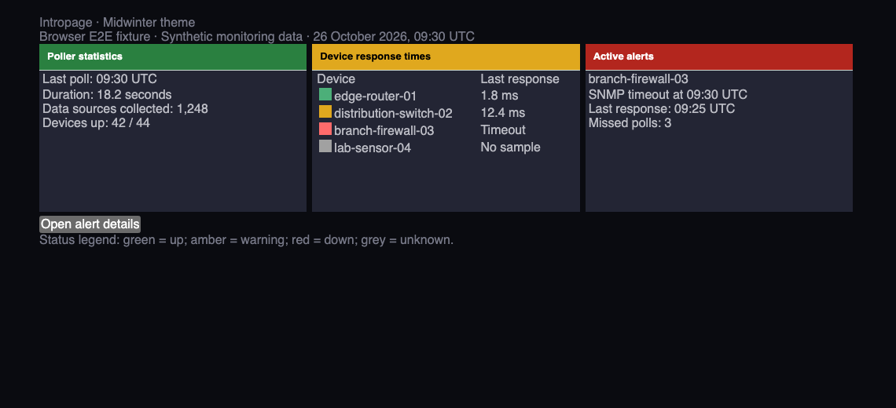
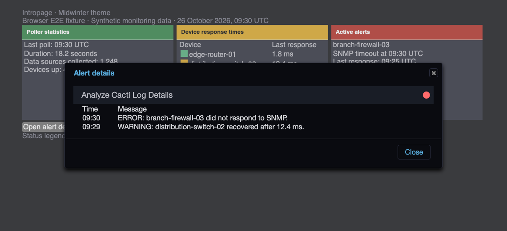
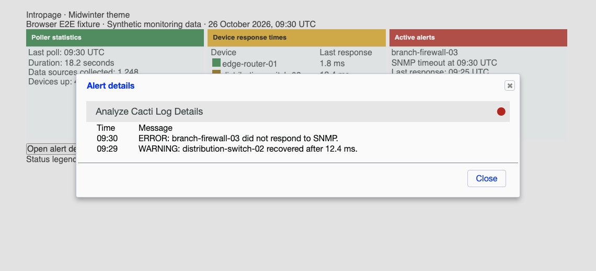

# Midwinter theme validation

Midwinter uses palette-specific indicator colors for dark and light surfaces.
Dark row markers use brighter green/red colors; light details dots and amber/grey
row markers use darker colors. Panel text uses the theme's readable text color.
Panel header colors remain unchanged.

Details-dot selectors also override Midwinter's generic dialog icon rule so an
error dot remains red when the real jQuery UI dialog opens.

## Populated browser fixtures

The tests load the actual core and plugin stylesheets, including Midwinter's
CSS imports, set its native palette/ready attributes, and wait for the body to
become visible. Device names, measurements, poller totals, and alerts are synthetic.
These are browser fixtures, not a live installation.




The browser opens a real jQuery UI details dialog, checks the alert data and red
error-dot color, and closes it. Indicator tests use panel backgrounds for row
markers and native widget styling for details dots.





## Reproduce

Use the setup in [Cacti theme validation](cacti-theme.md). Set `CACTI_ROOT` to the
adjacent core checkout and run from the plugin root:

```sh
NODE_PATH="$CACTI_ROOT/tests/e2e/node_modules" mise exec node@22 -- node \
  "$CACTI_ROOT/tests/e2e/node_modules/@playwright/test/cli.js" test \
  --config tests/e2e/playwright.config.cjs
```

Set `UPDATE_THEME_SCREENSHOTS=1` to regenerate screenshots in `tests/images/`. Both palettes cover
panel text and all four status colors on odd, even, and plain rows. Contrast checks
include alpha composition and sampled sRGB gradient interiors; they do not prove
contrast for arbitrary image backgrounds or every pixel.

After committing, measure changed CSS line coverage:

```sh
mise exec python@3.12 -- python "$CACTI_ROOT/tests/tools/report_changed_coverage.py" \
  --base fix/hollyberry-theme-status-contrast --language css --minimum 100 \
  --browser-root tests/e2e/test-results
```

This layer extends the shared contrast/browser tests above Hollyberry. Use
`origin/develop` after the lower stack layers merge. The gate measures executed
changed CSS lines, not whole-plugin or branch coverage.
