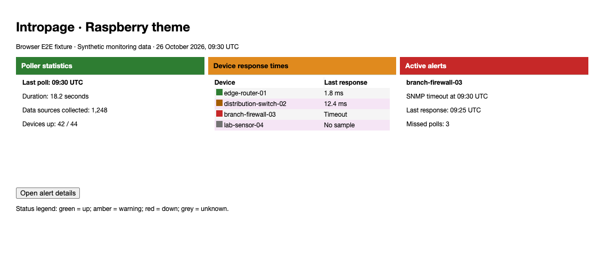
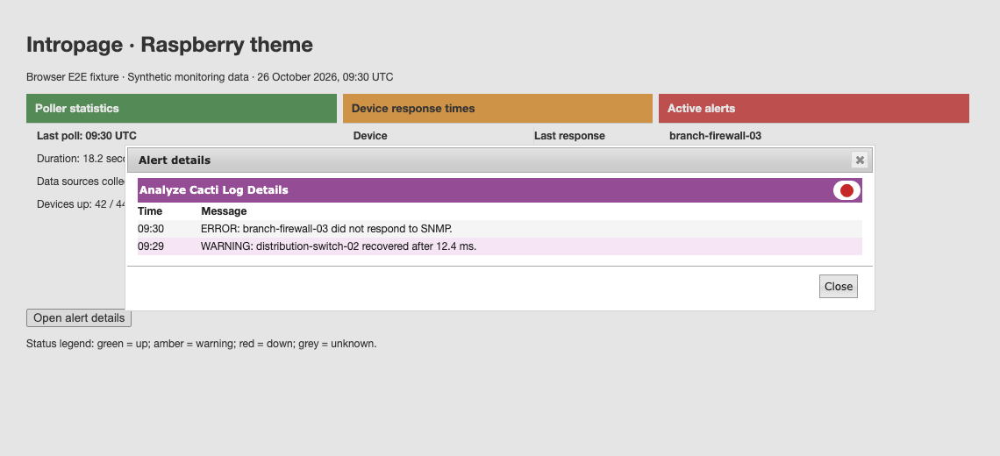

# Raspberry theme validation

Raspberry details dots use a neutral badge to separate them from the purple
titlebar. Amber and grey dots and row markers use darker colors for contrast on
light surfaces. Panel header colors remain unchanged.

## Populated browser fixtures

The tests load the actual core and plugin stylesheets. Device names,
measurements, poller totals, and alerts are synthetic. These are browser
fixtures, not a live installation.



The browser opens a real jQuery UI details dialog, checks its alert data, and
closes it. All four severity colors are checked on odd,
even, and plain rows and against the details badge.



## Reproduce

Use the setup in [Cacti theme validation](cacti-theme.md). Set `CACTI_ROOT` to the
adjacent core checkout and run from the plugin root:

```sh
NODE_PATH="$CACTI_ROOT/tests/e2e/node_modules" mise exec node@22 -- node \
  "$CACTI_ROOT/tests/e2e/node_modules/@playwright/test/cli.js" test \
  --config tests/e2e/playwright.config.cjs
```

Set `UPDATE_THEME_SCREENSHOTS=1` to regenerate screenshots. Contrast checks include
alpha composition and sampled sRGB gradient stops and interiors, including legacy
prefixed gradients. They do not prove contrast for arbitrary image backgrounds
or every pixel.

After committing, measure changed CSS line coverage:

```sh
mise exec python@3.12 -- python "$CACTI_ROOT/tests/tools/report_changed_coverage.py" \
  --base fix/paw-theme-status-contrast --language css --minimum 100 \
  --browser-root tests/e2e/test-results
```

This layer extends the shared contrast/browser tests above Paw. Use
`origin/develop` after the lower stack layers merge. The gate measures executed
changed CSS lines, not whole-plugin or branch coverage.
