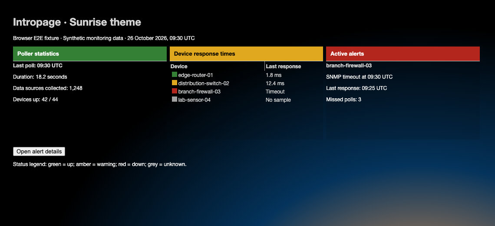
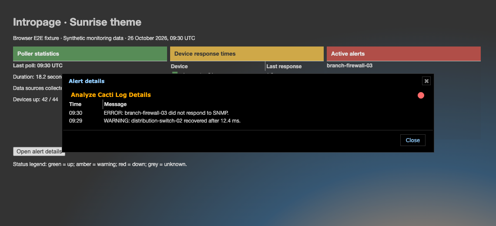

# Sunrise theme validation

Sunrise panels use light-grey inherited text so plain headings remain visible
on dark surfaces. Existing status colors and panel headers remain unchanged.

## Populated browser fixtures

The tests load the actual core and plugin stylesheets. Device names,
measurements, poller totals, and alerts are synthetic. These are browser
fixtures, not a live installation. The synthetic page heading outside the
application panels uses light grey so it is readable on the dark page.



The browser checks paragraph and heading contrast, opens a real jQuery UI details
dialog, checks its alert data, and closes it. All four status colors are also
checked against plain/odd/even rows and details titlebars.



## Reproduce

Use the setup in [Cacti theme validation](cacti-theme.md). Set `CACTI_ROOT` to the
adjacent core checkout and run from the plugin root:

```sh
NODE_PATH="$CACTI_ROOT/tests/e2e/node_modules" mise exec node@22 -- node \
  "$CACTI_ROOT/tests/e2e/node_modules/@playwright/test/cli.js" test \
  --config tests/e2e/playwright.config.cjs
```

Set `UPDATE_THEME_SCREENSHOTS=1` to regenerate screenshots. Contrast checks
compose alpha and sample linear-gradient stops and interiors. Sunrise's radial
page artwork uses its fallback color in these component checks; this does not
establish contrast for that artwork or every rendered pixel.

After committing, measure changed CSS line coverage:

```sh
mise exec python@3.12 -- python "$CACTI_ROOT/tests/tools/report_changed_coverage.py" \
  --base fix/raspberry-theme-status-contrast --language css --minimum 100 \
  --browser-root tests/e2e/test-results
```

This layer extends the shared browser tests above Raspberry in the native theme
stack. Use `origin/develop` after the lower layers merge. The gate measures
executed changed CSS lines, not whole-plugin or branch coverage.
